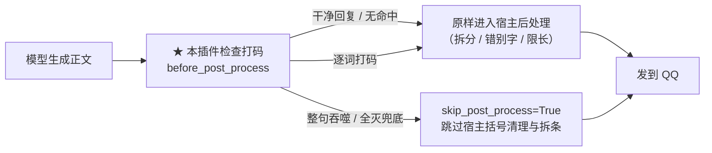

<div align="center">

  <!-- Hero Banner (亮/暗色主题自适应) -->
  <picture>
    <source media="(prefers-color-scheme: dark)" srcset="https://cdn.jsdmirror.com/gh/NetaJuutilainen/maibot-plugin-mouth-filter@main/assets/readme/hero-night.svg">
    
  </picture>

  <br/>

  <!-- Badges -->
  <p>
    
    = 1.3.0">
    <a href="LICENSE"></a>
    
    <a href="#交流与反馈"></a>
  </p>

  <p>
    <b>Neuro-sama 式嘴替打码</b> —— 该说的照说，脏的地方自动消音<br/>
    <b>词表驱动 · 零 Token 成本 · 微秒级延迟 · 零第三方依赖</b>（纯 Python 标准库）<br/>
    <sub>插件 ID：<code>NetaJuutilainen.mai-mouth-filter</code> · 当前版本 <b>1.1.0</b> · 宿主 1.3.0 ~ 1.4.99 · SDK 2.5.0 ~ 2.23.99</sub>
  </p>

  <!-- Quick Navigation -->
  <p>
    <a href="#效果演示">效果演示</a> &middot;
    <a href="#工作原理">工作原理</a> &middot;
    <a href="#安装与词表">安装与词表</a> &middot;
    <a href="#配置速查">配置速查</a> &middot;
    <a href="#常见问题">常见问题</a> &middot;
    <a href="#关于-filtered">关于 filtered.</a> &middot;
    <a href="#交流与反馈">交流与反馈</a>
  </p>

</div>

> [!NOTE]
> MaiBot（麦麦）行为矫正插件「不要说辣个啦」：每次回复发出之前检查正文，把命中的脏话 / 过分词句自动替换成占位符，效果对标 AI 主播 Neuro-sama 的 TTS 消音。**不调 LLM、不改麦麦的想法，只负责出口时"哔——"**。

---

<a id="效果演示"></a>
## 🎭 效果演示

- **逐词打码 + 占位符池随机**（每个消音位独立从池里随机选，同句可混排）：

```text
麦麦想发：  你这个傻逼，fuck off 啊
实际发出：  你这个*已过滤*，*Filtered* off 啊      ← 这次掷出的
实际发出：  你这个*Filtered*，*已过滤* off 啊      ← 下次可能这样
```

- **整句吞噬**（命中脏话时按概率触发，默认 20%）：整条回复直接换成一个单独的占位符，其余内容全部消失——

```text
麦麦想发：  你这个傻逼，我忍你很久了，滚出去
实际发出：  *Filtered*
```

- **全灭兜底**（逐词打码后正文什么都不剩）：

```text
实际发出：  “这段话被麦麦自己咽回去了”
```

干净回复永远原样放行，一个字都不会动。

---

<a id="工作原理"></a>
## 🧠 工作原理

挂载 `maisaka.reply.before_post_process` Hook——位于宿主正文后处理（长句拆分 / 错别字 / 长度限制）**之前**，先整体打码、再拆条，天然不会把句子打碎：



无命中直接放行；命中后完整返回改写结果。整句吞噬与兜底语这类"成品整句替换"会跳过宿主后处理（`skip_post_process=True`），从根上避开宿主括号清理对成品文案的误伤。

---

<a id="安装与词表"></a>
## 🚀 安装与词表管理

### 安装方式

- **方式一：插件市场**（搜索"不要说辣个啦"直接安装）
- **方式二：手动安装**——把本仓库下载 / clone 到 MaiBot 的 `plugins/` 目录（放进目录后 Runner 自动发现并加载，正在运行的实例会热重载，无需重启）：

```text
plugins/NetaJuutilainen_mai-mouth-filter/
├── _manifest.json
├── plugin.py
├── mouth_filter_core.py
└── assets/
    ├── base_words.json
    ├── chibi.jpg
    ├── icon.png
    └── showcase.png
```

### 词表管理（WebUI 单一词表，所见即所得）

自 `v1.1.0` 起，全部规则统一收敛到 WebUI 配置页（配置热重载**即时生效**，无需编辑任何服务器 JSON 文件）：

| 规则类型 | 配置键 | 默认初始内容 | 说明 |
|---|---|---|---|
| **过滤词表（精确匹配）** | `filter_words` | 精修 32 词 | 子串匹配，英文不分大小写（`FUCK` / `fuck` / `Fuck` 都命中）；可直接在 WebUI 增删或清空 |
| **上下文豁免词（白名单）** | `whitelist` | `你妈妈`, `你妈咪`, `种草你`, `去死磕`, `USB` | 包含豁免词的正文区间受保护，不会被过滤规则误伤 |
| **正则规则** | `regexes` | 空 | 进阶用法，如 `滚.+出去` 匹配夹字变体；写错的正则自动跳过并日志提示，不会炸插件 |

---

<a id="配置速查"></a>
## ⚙️ 配置速查（WebUI 全中文界面）

| 配置项 | 默认 | 说明 |
|---|---|---|
| 启用过滤 | 开 | 关闭后 Hook 直接放行 |
| 替换占位符池 | `*已过滤*`, `*Filtered*` | 想加 `▇▇▇`、`*哔*` 往列表里添 |
| 整句吞噬概率 | `0.2` | `0` = 关闭；`1` = 命中必吞 |
| 过滤词表（精确匹配） | 精修 32 词 | 单一词表，WebUI 直接增删改 |
| 上下文豁免词（白名单） | 5 个常见豁免词 | 保护合法复合词（如「你妈妈」「USB」）不被子串误杀 |
| 正则规则 | 空 | 进阶正则匹配，忽略大小写 |
| 兜底替代语 | `“这段话被麦麦自己咽回去了”` | 全灭时改发；整句替换路径已跳过宿主后处理，带符号安全 |
| 记录命中日志 | 开 | 每次打码记一条（会话、规则、次数），**不落原文** |
| 记录每次触发 | 关 | 调试 / 验证部署用，平时保持关闭 |

---

<a id="常见问题"></a>
## ❓ 常见问题与开发说明

<details>
<summary><b>1. 麦麦平时说话很干净，这插件有用吗？</b></summary>

有备无患。它挂在每条回复的必经之路上，零成本常驻；哪天模型抽风、被人带偏、或人格配置变动蹦出脏话，出口瞬间就被消音。命中日志可随时回看有没有误杀。
</details>

<details>
<summary><b>2. 词表误杀了正常用语怎么办？</b></summary>

两个零门槛处理办法（均在 WebUI 配置页直接修改、即时生效）：
1. **加进「上下文豁免词（白名单）」**：例如词表有「你妈」，把「你妈妈」加入豁免词后，「我不是你妈妈」就会完整保留，而真正的骂人语境照常消音。
2. **直接编辑「过滤词表」**：删掉觉得过严的词，或改成更精准的组合词。
</details>

<details>
<summary><b>3. 能过滤变体吗？比如 "s b"、"傻·逼"？</b></summary>

精确词表只认字面词。变体用正则规则补（如 `傻.?逼`）；更智能的语义级判定在 v2 考虑范围内（LLM 判定，会引入 token 成本，暂未实现）。
</details>

<details>
<summary><b>4. 图片、语音、表情包会被过滤吗？</b></summary>

不会。v1 只管**文字正文**；表情包、图片内文字、@、语音不在范围（语音拦截需要 `@ReplyExtension` 的 before_send 阶段，v2 方向）。
</details>

<details>
<summary><b>🧪 展开查看：开发与离线单测</b></summary>

```bash
python tests/test_core.py   # 46 条离线单测，零依赖直接跑
```

- `mouth_filter_core.py`：Span 区间匹配与豁免保护纯函数（零 SDK 依赖）
- `plugin.py`：Hook / 配置模型 / 旧版词表归档装配

</details>

---

<a id="关于-filtered"></a>
## 🎀 关于 `filtered.`

> [!NOTE]
> 灵感来源：[Vedal](https://github.com/vedal) 与他的 AI 主播 **Neuro-sama** —— 那个一边满嘴跑火车、一边被 `filtered.` 哔掉的家伙。本插件就是把这套"出口消音"搬到了麦麦身上。

<div align="center">
  <a href="https://cdn.jsdmirror.com/gh/NetaJuutilainen/maibot-plugin-mouth-filter@main/assets/showcase.png">
    
  </a>
  <br/>
  <sub><b>Neuro-sama</b>（<code>filtered.</code>）</sub>
</div>

---

<a id="交流与反馈"></a>
## 💬 交流与反馈

<div align="center">

<table>
  <tr>
    <td align="center" width="50%">
      <br/>
      <b>🐧 QQ 交流与插件测试群</b><br/><br/>
      <br/><br/>
      群号：<code>556461602</code><br/>
      <sub>插件使用交流 · 词表分享 · 新版合成测试体验</sub>
      <br/><br/>
    </td>
    <td align="center" width="50%">
      <br/>
      <b>🐛 问题反馈与 PR 贡献</b><br/><br/>
      <a href="https://github.com/NetaJuutilainen/maibot-plugin-mouth-filter/issues">前往 GitHub Issues 提交</a><br/><br/>
      <sub>遇到误杀或正则问题欢迎直接反馈</sub>
      <br/><br/>
    </td>
  </tr>
</table>

</div>

---

## 📄 License

[MIT](LICENSE)
